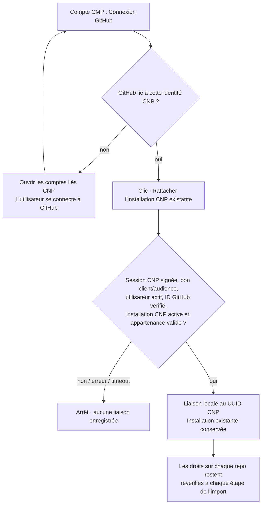

# Connexion GitHub depuis CMP

## Cause du refus « organization owner »

L’ancien bouton ouvrait toujours `https://github.com/apps/cnp-portal/installations/new`.
Cette page installe l’App ou modifie son installation d’organisation ; elle ne
sert pas à simplement lier une identité utilisateur. Les permissions d’organisation
et les restrictions GitHub peuvent réserver cette opération à un owner.

Contrôle réel du 25 octobre 2026 : l’App CNP est déjà installée, active sur 3-Istor,
avec accès à Session Manager. Le compte GitHub JoeBejjani est membre de 3-Istor.
Le diagnostic a utilisé seulement members:read, sans modifier de rôle, de permission
ni d’installation. À ce moment, son identité GitHub n’était pas liée dans Keycloak.

## Nouveau parcours

Dans CMP local, ouvrir **Compte → Connexion GitHub** :

1. Cliquer **Lier mon compte GitHub dans CNP** si l’identité est absente.
2. Le bouton ouvre directement **Comptes liés / Linked accounts** : cliquer sur **Lier / Link** pour GitHub.
   Chemin vérifié sur le Keycloak déployé : `/realms/3istor/account/account-security/linked-accounts`.
   Dans les menus anglais, cette page se trouve sous **Account security → Linked accounts**.
3. Revenir sur CMP et actualiser si nécessaire.
4. Cliquer **Rattacher l’installation CNP existante**.

L’ID d’installation est choisi côté serveur depuis GITHUB_INSTALLATION_ID.
L’utilisateur n’a pas à le deviner ni à réinstaller l’App. La liaison ne donne
aucun rôle GitHub supplémentaire. Le contrôle d’organisation accepte un membre
actif, sans exiger un rôle owner. Pour une installation personnelle renseignée
via l’ancienne API, seul son propriétaire GitHub vérifié peut la rattacher.

## Fichiers de la correction

| Fichier | Rôle |
| --- | --- |
| frontend/src/components/account/GitHubLinkButton.tsx | Remplace la réinstallation systématique par les deux étapes identité / installation existante. Aucun enregistrement automatique d’un ID reçu dans l’URL. |
| frontend/src/lib/api.ts, frontend/src/types/index.ts | Appels GET account/github et POST account/github-connect. L’ancien statut utilisé par le catalogue reste compatible. |
| backend/app/services/github_account.py | Vérifie identité active et fédération, App ID, suspension, correspondance de l’ID utilisateur GitHub et appartenance active ; persiste seulement ensuite. |
| backend/app/services/github_service.py | Possibilité de demander un token d’installation à permissions réduites. Le contrôle d’organisation ne demande que members:read. |
| backend/app/routers/account.py, schemas/account.py | Nouvelles routes authentifiées ; ancienne route github-installation soumise aux mêmes vérifications. Lecture des UUID et anciens noms utilisateurs. |
| backend/app/models/user_github.py | Documente la clé canonique UUID et la compatibilité des anciennes lignes, sans migration de schéma. |
| backend/app/services/repository_imports.py | Réutilise la même fédération GitHub ; envoie le User-Agent déjà requis par le proxy Keycloak pour charger les clés de signature. |
| backend/tests/test_github_account.py | Refus avant écriture, identité/client/audience, membre ordinaire, ID App numérique réel, suspension, compte personnel, anciennes routes/lignes et tokens limités. |

Les anciennes lignes username/UUID du même utilisateur sont regroupées seulement
après vérification réussie. La lecture du statut revalide une installation déjà
enregistrée ; une indisponibilité n’est pas présentée comme une connexion valide.
La connexion fonctionne indépendamment d’IMPORT_ENABLED et ne déclenche pas d’import.

## Permissions de l’App à faire relire par son administrateur

Cette correction ne modifie aucune permission globale de l’App et n’installe rien.
Elle évite de demander une nouvelle approbation d’organisation pour un rattachement
utilisateur à une installation qui a déjà été approuvée.

Les permissions utiles repérées pour **l’import central** sont :

| Permission | Besoin |
| --- | --- |
| Metadata : read | Métadonnées et identité des repos. |
| Contents : read/write | Lecture source/chart, branche et fichiers préparés par PR, mise à jour du registre. Les tokens du worker restent limités aux repos et opérations autorisés. |
| Pull requests : read/write | Ouvrir la PR, lire les revues et vérifier sa fusion. |
| Actions : read/write | Dispatch et annulation de la CI centrale. |
| Actions variables : read | Vérifier le callback et l’audience avant dispatch. La modification initiale des variables est une opération d’administration séparée. |
| Organization members : read | Vérifier l’appartenance de l’identité GitHub à l’installation d’organisation. |

Le **catalogue CMP existant** a aussi des usages distincts : création/suppression de
repos (Repository administration), fichiers de workflows (Workflows) et secret
Discord (Actions secrets). Il faut les conserver ou confirmer leur remplacement
avant de réduire les permissions globales. La publication GHCR de la CI utilise
son GITHUB_TOKEN ; le pull cluster utilise le credential GHCR déjà configuré.
La liste actuelle de l’App est beaucoup plus large que ces besoins. Son nettoyage
global demande la validation du propriétaire de l’App/organisation et la vérification
de ses autres consommateurs ; il n’a pas été effectué ici.

## Validation

Backend : 579 tests réussis, dont 23 nouveaux tests de liaison GitHub. Lint/types
et build frontend réussis. Cinq scénarios Chromium avec session/API simulées :
identité absente, rattachement existant, connecté, refus, callback non fiable.
Le test réel en lecture a confirmé le compte et l’installation existante. La
connexion OAuth et le clic de rattachement doivent être terminés par l’utilisateur.

L’import réel reste soumis aux autres prérequis de recette : CI et chart publiés,
pins, callback HTTPS et Argo compatibles. Corriger la liaison GitHub ne les active
pas implicitement. Aucun push ni changement de permissions GitHub effectué.

Sources : [installation et autorisation d’une GitHub App](https://docs.github.com/en/apps/using-github-apps/installing-a-github-app-from-a-third-party),
[restrictions d’installation](https://docs.github.com/en/organizations/managing-programmatic-access-to-your-organization/limiting-oauth-app-and-github-app-access-requests-and-installations),
[API des membres d’organisation](https://docs.github.com/en/rest/orgs/members).
