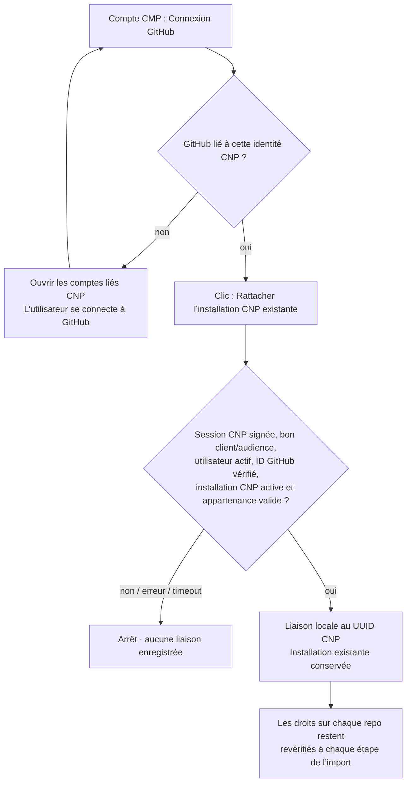

> Résultats et limites de la reprise : [statut du 29 octobre](../../extern-project-analyzer/docs/import-oct29-status.md).

# Connexion GitHub depuis CMP

## Cause du refus « organization owner »

L’ancien bouton ouvrait toujours `https://github.com/apps/cnp-portal/installations/new`.
Cette page installe l’App ou modifie son installation d’organisation ; elle ne
sert pas à simplement lier une identité utilisateur. Les permissions d’organisation
et les restrictions GitHub peuvent réserver cette opération à un owner.

Contrôle réel du 25 octobre 2026 : l’App CNP est déjà installée, active sur 3-Istor,
avec accès à Session Manager. Le compte GitHub JoeBejjani est membre de 3-Istor.
Le diagnostic a utilisé seulement members:read, sans changer de rôle ni réinstaller
l’App. À ce moment, son identité GitHub n’était pas liée dans Keycloak.

## État vérifié au 29 octobre 2026

La vérification d’administration précédente avait confirmé l’absence de fournisseur
GitHub dans le realm 3istor. Le menu Linked accounts était donc indisponible. Le
lien direct renvoyait un HTTP 200 mais échouait dans la console authentifiée : sa
réponse HTTP et sa présence dans le JavaScript ne prouvaient pas que la page était
disponible.

Le secret OAuth a déjà été fourni dans un fichier local hors Git, protégé par le
mode 0600. Sa valeur ne doit être ni affichée ni ajoutée au dépôt. Joe a ajouté
la permission utilisateur **Email addresses: Read**, dont la présence a été
confirmée. Cette permission ne prouve pas que le parcours OAuth est configuré.

Le champ de callback n’a pas été retrouvé ni confirmé dans **General** : l’interface
GitHub affichée diffère de celle décrite dans la documentation. Le fournisseur
GitHub n’a pas été activé dans Keycloak et aucune liaison GitHub réelle n’a été
réalisée. La validation du callback reste nécessaire avant toute activation. La
configuration et le callback attendus sont décrits dans
[K3s/k8s/config/keycloak/GITHUB_IDENTITY_PROVIDER.md](../../K3s/k8s/config/keycloak/GITHUB_IDENTITY_PROVIDER.md),
avec le module Terraform natif désactivé par défaut et le contrôle de plan associé.

CMP ne propose plus le lien tant que GITHUB_ACCOUNT_LINK_URL est vide. Après
configuration et test OAuth du provider, cette variable peut recevoir l’URL des
comptes liés. Elle ne donne aucun droit et ne remplace aucune vérification.

## Nouveau parcours (après configuration du provider)

Dans CMP local, ouvrir **Compte → Connexion GitHub** :

1. Cliquer **Lier mon compte GitHub dans CNP** si l’identité est absente.
2. Le bouton ouvre directement **Comptes liés / Linked accounts** : cliquer sur **Lier / Link** pour GitHub.
   Chemin prévu, à valider après configuration du fournisseur : `/realms/3istor/account/account-security/linked-accounts`.
   Dans les menus anglais, l’entrée attendue est **Account security → Linked accounts**.
3. Revenir sur CMP et actualiser si nécessaire.
4. Cliquer **Rattacher l’installation CNP existante**.

L’ID d’installation est choisi côté serveur depuis GITHUB_INSTALLATION_ID.
L’utilisateur n’a pas à le deviner ni à réinstaller l’App. La liaison ne donne
aucun rôle GitHub supplémentaire. Le contrôle d’organisation accepte un membre
actif, sans exiger un rôle owner. Pour une installation personnelle renseignée
via l’ancienne API, seul son propriétaire GitHub vérifié peut la rattacher.

## Fichiers de la correction

| Fichier | Rôle |
| --- | --- |
| frontend/src/components/account/GitHubLinkButton.tsx | Remplace la réinstallation systématique par les deux étapes identité / installation existante. Aucun enregistrement automatique d’un ID reçu dans l’URL. |
| frontend/src/lib/api.ts, frontend/src/types/index.ts | Appels GET account/github et POST account/github-connect. L’ancien statut utilisé par le catalogue reste compatible. |
| backend/app/services/github_account.py | Vérifie identité active et fédération, App ID, suspension, correspondance de l’ID utilisateur GitHub et appartenance active ; persiste seulement ensuite. |
| backend/app/services/github_service.py | Possibilité de demander un token d’installation à permissions réduites. Le contrôle d’organisation ne demande que members:read. |
| backend/app/routers/account.py, schemas/account.py | Nouvelles routes authentifiées ; ancienne route github-installation soumise aux mêmes vérifications. Lecture des UUID et anciens noms utilisateurs. |
| backend/app/models/user_github.py | Documente la clé canonique UUID et la compatibilité des anciennes lignes, sans migration de schéma. |
| backend/app/services/repository_imports.py | Réutilise la même fédération GitHub ; envoie le User-Agent déjà requis par le proxy Keycloak pour charger les clés de signature. |
| backend/tests/test_github_account.py | Refus avant écriture, identité/client/audience, membre ordinaire, ID App numérique réel, suspension, compte personnel, anciennes routes/lignes et tokens limités. |

Les anciennes lignes username/UUID du même utilisateur sont regroupées seulement
après vérification réussie. La lecture du statut revalide une installation déjà
enregistrée ; une indisponibilité n’est pas présentée comme une connexion valide.
La connexion fonctionne indépendamment d’IMPORT_ENABLED et ne déclenche pas d’import.

## Permissions de l’App à faire relire par son administrateur

Le code de rattachement réutilise l’installation existante. L’ajout de la permission
utilisateur **Email addresses: Read** par Joe est distinct des permissions
d’organisation et de dépôt recensées ci-dessous. Une approbation d’organisation
n’est pas demandée par ce code pour le simple rattachement utilisateur à
l’installation déjà approuvée.

Les permissions utiles repérées pour **l’import central** sont :

| Permission | Besoin |
| --- | --- |
| Metadata : read | Métadonnées et identité des repos. |
| Contents : read/write | Lecture source/chart, branche et fichiers préparés par PR, mise à jour du registre. Les tokens du worker restent limités aux repos et opérations autorisés. |
| Pull requests : read/write | Ouvrir la PR, lire les revues et vérifier sa fusion. |
| Actions : read/write | Dispatch et annulation de la CI centrale. |
| Actions variables : read | Vérifier le callback et l’audience avant dispatch. La modification initiale des variables est une opération d’administration séparée. |
| Organization members : read | Vérifier l’appartenance de l’identité GitHub à l’installation d’organisation. |

Le **catalogue CMP existant** a aussi des usages distincts : création/suppression de
repos (Repository administration), fichiers de workflows (Workflows) et secret
Discord (Actions secrets). Il faut les conserver ou confirmer leur remplacement
avant de réduire les permissions globales. La publication GHCR de la CI utilise
son GITHUB_TOKEN ; le pull cluster utilise le credential GHCR déjà configuré.
La liste actuelle de l’App est beaucoup plus large que ces besoins. Son nettoyage
global demande la validation du propriétaire de l’App/organisation et la vérification
de ses autres consommateurs ; il n’a pas été effectué ici.

## Validation

Le dernier passage complet du backend après intégration de main compte
604 tests réussis. Le résultat de 581 tests, dont 25 tests de liaison GitHub,
correspond à une validation antérieure. Les vérifications lint/types et build
frontend ont réussi. Six scénarios Chromium ont utilisé une session et des API
simulées : provider non configuré, identité absente, rattachement existant,
connecté, refus, callback non fiable. Les tests du protocole utilisent aussi des
services simulés ; ils ne valident pas une connexion OAuth réelle.

Le contrôle réel antérieur en lecture a confirmé le compte et l’installation
existante. Le callback reste non confirmé, le broker inactif et la liaison réelle
non réalisée. Cette mise à jour documentaire ne lance aucun test, push, appel SSO
ou accès cluster.

L’import réel reste soumis aux autres prérequis de recette : CI et chart publiés,
pins, callback HTTPS et Argo compatibles. Corriger la liaison GitHub ne les active
pas implicitement. Leur validation reste obligatoire avant tout import connecté.

Sources : [installation et autorisation d’une GitHub App](https://docs.github.com/en/apps/using-github-apps/installing-a-github-app-from-a-third-party),
[restrictions d’installation](https://docs.github.com/en/organizations/managing-programmatic-access-to-your-organization/limiting-oauth-app-and-github-app-access-requests-and-installations),
[API des membres d’organisation](https://docs.github.com/en/rest/orgs/members).
